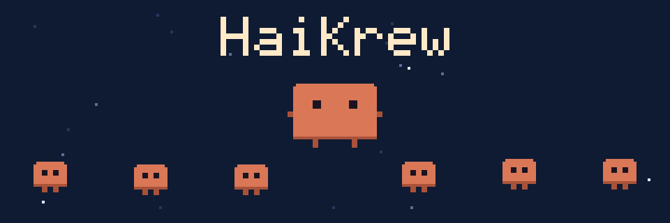

# HaiKrew



HaiKrew is a Claude Code mod (plugin) for token-efficient agent crews. The main model plans and reviews; cheaper Haiku subagents write code and do research; deterministic hooks gate which model a subagent runs on and trim noisy command output before it reaches the context.

Unofficial community plugin; not affiliated with Anthropic.

## Why

A subagent launched without a `model` inherits the main model, so every default agent runs on the most expensive model. HaiKrew routes code-writing and research to Haiku, keeps the main model on planning and review, and cuts noisy output deterministically (a hook shortens build logs; it does not ask a model to summarise them).

## What's inside

- **Model gate** (`agent.spawn`): off until you turn it on in `/haikrew` (the switch in the pane's header, hotkey `g`, or Settings). When on, it sets a model on every subagent launch that lacks one, and refuses Opus unless allowed.
- **Effort** (`turn.step`): a rule ending in `@<effort>`, or `gate.default_effort`, sets how hard a subagent thinks. Main conversation untouched.
- **Agent instructions** (`agent.spawn`): `gate.instructions` text is added to the prompt of matching subagents.
- **Hook-bypass guard** (`tool.call` on Bash): refuses `--no-verify` and `core.hooksPath` overrides.
- **Seam check** (`classic.SubagentStop`): when the last of two or more parallel agents in one folder finishes, says to run the full verify.
- **Squeeze** (`tool.call` on Bash): runs noisy commands such as `cargo test` or `xcodebuild` through `haikrew squeeze`, which prints a short verdict and keeps the full log on disk.
- **Read guard** (`tool.call` on Read): a large file read without a line range returns an outline and asks for a range.
- **Ledger** (`classic.SubagentStop`): one row per finished subagent (model, job, language, time, tokens, verdict). The verdict is the last `VERDICT: PASS|FAIL` or `STATUS: done|blocked` line of its final message (done counts as pass, blocked as fail); a run with neither is unjudged and left out of pass rates. Tokens are new work: input, cache writes and output, with cache reads kept apart, counted live from each step. Output counts in subagent transcripts are often stream-start snapshots, lower than the final count, so live counts are used when available; a run known only from its transcript shows its output as a lower bound. On its first start, 0.6.3 re-reads the transcripts of kept runs once to repair their verdicts and input tokens; their output stays marked as an estimate. The newest 200 rows are kept in full; older rows fold into monthly averages, and monthly averages older than 12 months fold into yearly ones.
- **`/haikrew` pane**: in the desktop app one page: a pixel-art banner with the model gate switch, then Controls, Your crew (each working agent's latest message), Token use, Track record and Settings, each a card that folds to one line. The band above the prompt (Settings › Prompt widget) shows the crew as Claude bots acting out their work: the main agent first, larger and in its model's colour (Haiku purple, Sonnet teal, Opus orange by default, colours your choice), directing, waiting, resting or working, wearing a crown, wizard hat or cap; each subagent reads, edits, runs a command, searches the web, thinks, finishes, fails, or shows an alarm past its token warning. Behind them a landscape (mountains, city, forest or hills) with its atmosphere: a sky that follows your clock, sunrise to night with twinkling stars and the real moon phase, optional clouds, and snow in winter or falling leaves in autumn over forests and hills. Hovering a bot shows who it is and its latest line, with a Transcript button that opens that agent's messages and tool calls in a HaiKrew pane; hovering the sun or moon shows a button that opens this pane. The terminal gets a plain three-tab version (Home, Ledger, Settings).
- **Ledger advice**: the Track record suggests a stronger model for a tagged job that keeps failing (4+ judged runs under 60%) and a cheaper one for a job a stronger model nearly always passes (8+ judged runs at 90% or more, unless the cheaper model already fails it). Runs without a `HAIKREW job=` tag get a job inferred from the prompt's opening and the agent type, shown as "(inferred)"; inferred jobs get no rule suggestions, because the gate reads only tags.
- **Retry one model up**: a failed agent in the crew card offers "Retry on Sonnet" (or Opus, when allowed). It asks the main conversation to run the same task again on that model, so the main model still checks the result.
- **Review tiers** (`classic.SubagentStop`): each finished agent that changed files gets a tier (light, standard or deep) from its paths, size, job, tests and its model's record. Light, for docs and tests only, is checked by the main model with `record_verdict`; standard and deep go to a reviewer model and effort set in Settings › Review. See Review tiers under How the crew works.
- **Agent tools** (off by default, Settings › General › Agent control): `status`, `set_setting`, `add_rule`, `remove_rule`, `review_packet`, `record_verdict`, listed as `mcp__haikrew__<name>`. "Read" allows `status` and `review_packet`; "Change" allows all six, settings and rules validated like the pane. Agents can never change the agent-control setting or turn on Allow Opus; every change shows a toast.
- **`haiku-coder` agent**: implements a tightly written spec.
- **`haiku-scout` agent**: answers one research question with a short cited brief.
- **`crew-overseer` skill**: the overseer workflow: write the spec, dispatch Haiku, review by tier, verify.
- **CLI** (`bin/haikrew.mjs`): `squeeze`, `verify`, `patterns check`.

## What HaiKrew changes and touches

- **`agent.spawn`** (every subagent launch passes through this hook): does nothing while `gate.enabled` is off, which is the default; the launch goes on exactly as requested. Once you turn the gate on, it sets the model when the caller named none (or, with `gate.rules_override` on, when a rule matches), choosing from `gate.rules` first, then the default. Refuses Opus subagents unless `gate.allow_opus` is on. Refuses nested spawns when `gate.allow_nested` is off. Adds `gate.instructions` text to the prompt of matching subagents, under the line "Instructions from HaiKrew settings:" (empty by default). Why: cost control is the plugin's purpose, and every rule is a setting you control in `/haikrew`. It never changes Claude Code's permission mode or answers a permission prompt; a refusal comes back to the caller with the reason and the setting that caused it.
- **`prompt.context`** (the context Claude reads at the start of each request): while the gate is on and `gate.delegate` is on (the default), adds a short note to the end of the CLAUDE.md text of the main conversation, never a subagent's. The note is your standing request to hand spec-able work to `haiku-coder` and `haiku-scout` and to keep design and sensitive reviews inline, and it states the current default model, Opus setting, routing rules and nesting setting, and how to follow a review note. Why: the gate only picks a model once an agent is launched, and Claude Code's own default is to start agents only when you ask; the note is what makes the crew the default. Turn `gate.delegate` off to keep the gate without the note.
- **`turn.step`** (every model request, the main conversation's and each subagent's, passes through this hook): sets the effort of a subagent's requests when the gate chose one for it at launch (a rule's `@effort` or `gate.default_effort`). Requests of the main conversation and of other agents pass on unchanged. Nothing happens while the gate is off.
- **`tool.call`** (all tools): notes the tool name and time for the Crew tab's live roster, then passes the call on unchanged.
- **`tool.call`** on Bash: refuses a command containing `--no-verify`, `core.hooksPath=` or `-c core.hooksPath`, with a reason (`checks.guard_hooks`, on by default). Refuses a command that matches a squeeze pattern, with a message suggesting the `haikrew squeeze` command instead.
- **`tool.call`** on Read: refuses a whole-file read of a file longer than `read_guard.max_lines`, and returns an outline so the caller can ask for a range.
- **`session.start`**: registers the `/haikrew` command.
- **`command.run`** for `/haikrew` (`command.run` is also the name of the call that runs a command): opens the HaiKrew pane and returns "HaiKrew pane opened."; other commands pass through untouched.
- **`ui.render`** and **`ui.close`**: draw the HaiKrew pane and stop its animation when it closes; other panes pass through untouched.
- **`classic.SubagentStop`**: reads the finished subagent's transcript at the path Claude Code provides, to compute ledger fields. When the last of two or more agents that ran at the same time in one folder finishes, writes a reminder to run the full verify to the session log (`$.ui.log`). With `checks.seam_check` on (off by default), it also submits that reminder as a prompt (`$.prompt.submit`), which Claude Code runs once the session is idle. The prompt is exactly: `HaiKrew seam check: <n> agents ran in parallel in <folder>. Run the repo's full verify before trusting their reports.`, where `<n>` is the number of agents and `<folder>` is the session's folder. It carries no conversation text, file contents or agent output, and nothing is sent anywhere else. After a finished agent that changed files, it picks the review tier, stores the review packet and appends a one-line review note to the session. A review agent gets no tier of its own; its `VERDICT: PASS|FAIL for <name>` line records that verdict on the named run instead.
- **Session folder**: `agent.spawn` reads the session's folder (`$.session.cwd()`) for `cwd:` selectors and the seam check. `~` in a selector is the `/Users/<name>` or `/home/<name>` part of that folder.
- **Ledger suggestions**: the Ledger tab suggests a rule when a job and language on one model pass less than 60% of at least 4 runs. A suggestion is added to `gate.rules` only when you press its button twice.
- **Storage**: the mod uses `$.store` only, for settings, the ledger and review packets (the spec and report of each reviewed agent; the newest 20 are kept). The mod writes no files.
- **Network**: none.
- **Programs started by the mod**: none. The squeeze command is only suggested to Claude, which runs it through its normal permission checks. When Claude runs `haikrew squeeze`, the CLI writes the full log under `haikrew/logs` in the system temp folder.
- **Session usage**: the Tokens tab shows this session's context size, rate-limit use and cost from Claude Code's `$.session.usage()`, on screen only. Nothing is stored or sent.
- **Credentials**: none read. No environment variables or keychain entries are read by the mod or the CLI. Files under `~/.claude` are not read, except subagent transcripts: the one-time ledger repair re-reads the transcripts of kept runs under `~/.claude/projects` for their verdicts and token counts, and each finished subagent's transcript is read as described under `classic.SubagentStop`.

## Layout

The plugin bundle is in `plugin/` (manifest, hooks, mod source, CLI, agents, skills). The repository root holds this README, the license, assets, scripts, tests, and the marketplace manifest.

## Requirements

- Claude Code 2.1.287 or later (for mods and `plugin test`).
- Node 22.18 or later for the CLI. The CLI runs TypeScript directly through Node's type stripping and has no build step or dependencies.

## Install

Try it for one session, from a clone of this repository:

```sh
claude --plugin-dir /path/to/HaiKrew/plugin
```

Install from GitHub:

```text
/plugin marketplace add adriancmurray/HaiKrew
/plugin install haikrew@haikrew
```

The marketplace is named `haikrew` and lists one plugin, `haikrew`, whose source is `./plugin` in `.claude-plugin/marketplace.json`.

## CLI

`bin/haikrew.mjs` runs anywhere Node 22.18 or later runs:

- `squeeze [--max-lines N] [--wrap PREFIX] -- <cmd...>`: runs a command, prints a short verdict and keeps the full log on disk.
- `verify`: runs `.haikrew/verify` if present, or an inferred build and test, and prints one `VERDICT:` line.
- `patterns check [--dir PATH] [--max-files N] [--max-lines N]`: counts the `.md` files in a patterns folder and their lines. The folder is `--dir`, resolved against the current directory, or `./patterns` by default. The caps default to 20 files and 40 lines. Exit 0 within caps, 1 with one `violation:` line per problem, 2 when the folder is missing or is not a directory (`patterns: no patterns folder at <path> (pass --dir)` on stderr). An empty folder passes.

## Settings

Settings are kept in the mod store (`$.store`, key `settings`), not in a file, and apply to every session. Edit them in `/haikrew`: rules and instructions are built there as sentences from dropdowns and buttons, default effort is a row of buttons per model, and the squeeze patterns are named switches; the stored values keep the formats below. Defaults come from `plugin/src/schema.ts`. Values are validated on save.

| Key | Default | What it does |
|---|---|---|
| `gate.enabled` | `false` | Turn the gate on. Off by default: until you turn it on, agent launches pass through unchanged. |
| `gate.delegate` | `true` | While the gate is on, add the delegation note to the main conversation's CLAUDE.md text (see `prompt.context` above). |
| `gate.default_model` | `"haiku"` | Model given to an agent launched without one. |
| `gate.allow_opus` | `false` | Allow subagents to run on Opus at all. Off: an Opus request is refused with a reason. |
| `gate.pinned_types` | `["haiku-coder"]` | Agent types whose own definition sets the model; the gate leaves them alone. |
| `gate.allow_nested` | `true` | Let a subagent start agents of its own. |
| `gate.nested_model` | `"haiku"` | Model given to an agent a subagent starts without naming one. |
| `gate.rules` | `["job:review=sonnet", "job:research=haiku", "type:Explore=haiku"]` | Ordered rules, first match wins: selectors joined by `+`, then `=haiku`, `=sonnet` or `=opus`, optionally `@low` to `@max`. Selectors: `job:<tag>`, `lang:<tag>`, `type:<agent type>`, `desc:<words>`, `cwd:<glob>`. |
| `gate.rules_override` | `false` | Let rules replace a model the caller named. |
| `gate.default_effort` | `[]` | Effort for subagents on a model when no rule sets one, e.g. `sonnet=high`. Empty: effort is left as it is. |
| `gate.instructions` | `[]` | Text added to matching subagents' prompts: `<selectors>: <text>`, one entry per row in the pane. |
| `checks.guard_hooks` | `true` | Refuse Bash commands that skip git hooks. |
| `checks.seam_check` | `false` | Also send the seam reminder as a prompt; off: it is only logged. |
| `checks.token_limits` | `haiku=800000`, `sonnet=400000`, `opus=200000` | Warn when one subagent's new work (input, cache writes and output; cache reads not counted) passes its model's limit: a toast, a mark in the crew and a `!` above it in the band. A model left out, or `0`, never warns; an unknown model uses the lowest limit. |
| `checks.token_effort_scale` | `true` | Multiply each limit by the agent's effort: low ×0.5, medium ×1, high ×1.5, xhigh ×2, max ×3. |
| `review.enabled` | `true` | Pick a review tier for each finished agent that changed files. Off: finished agents are not reviewed. |
| `review.sensitive_paths` | `["**/hooks/**", "**/auth/**", "**/*auth*", "**/*secur*", "**/*crypt*", "**/migrations/**", "**/*.lock", "**/.github/**", "**/Package.swift", "**/Cargo.toml", "**/package.json"]` | Path globs whose change always means a deep review. `**` is any folders, `*` one name, `?` one character. |
| `review.light_paths` | `["**/*.md", "**/docs/**", "**/tests/**", "**/*.test.*", "**/*.spec.*", "**/test_*"]` | Path globs. Only changes to these can get a light review. |
| `review.light_lines` | `60` | A light review needs fewer lines than this, and only light paths changed. |
| `review.deep_lines` | `400` | Changes of at least this many lines always get a deep review. |
| `review.standard_reviewer` | `"sonnet@medium"` | Model and effort of the reviewer for a standard review, as `model@effort`. |
| `review.deep_reviewer` | `"sonnet@high"` | Model and effort of the reviewer for a deep review. Opus needs `gate.allow_opus`; without it, Sonnet at high effort reviews. |
| `review.deep_inline` | `false` | On: the main model reviews a deep change itself when it is at least as strong as the deep reviewer, and no reviewer runs. Off: a reviewer agent does it. |
| `review.deep_jobs` | `["security", "migration", "concurrency", "protocol"]` | Jobs (the `HAIKREW job=` tag) that always get a deep review. |
| `squeeze.enabled` | `true` | Redirect matching commands. |
| `squeeze.patterns` | 7 regexes (cargo, swift, xcodebuild, pytest, npm/pnpm/yarn/bun, go, make) | Regexes matched against the start of a Bash command. |
| `squeeze.max_lines` | `20` | Most lines a summary prints. Passed to the CLI as `--max-lines`. |
| `squeeze.wrap_prefix` | `""` | Optional command prefixed to every squeezed run, e.g. a build lock wrapper. Passed to the CLI as `--wrap`. |
| `read_guard.enabled` | `true` | Turn the guard on or off. |
| `read_guard.max_lines` | `600` | Files longer than this need an offset/limit. |
| `ledger.enabled` | `true` | Record finished subagents. |
| `ledger.raw_limit` | `200` | Newest rows kept in full; older rows fold into monthly averages. |
| `ledger.yearly_after_months` | `12` | Monthly averages older than this fold into yearly ones. |
| `pane.open_on_start` | `false` | Open the `/haikrew` pane by itself whenever a session starts. |
| `pane.time_style` | `"relative"` | How limit resets and past runs are shown: `relative` (in 2 h 14 min, 3 h ago), `clock` (at 6:00 PM, your time zone) or `both`. |
| `band.show` | `true` | In the desktop app, show the animated crew in the band above the prompt. |
| `band.sky` | `"live"` | The sky behind the crew: `live` (your clock), `dawn`, `day`, `dusk` or `night`. |
| `band.scenery` | `"mountains"` | The landscape behind the crew: `mountains`, `city`, `forest` or `hills`. |
| `band.season` | `"auto"` | Snow in `winter`; falling leaves in `autumn` over forests and hills. `auto` picks the season by month; `spring`, `summer` and `none` draw neither. |
| `band.clouds` | `true` | Pixel clouds drifting across the sky. |
| `band.headwear` | `"crown"` | What the main agent wears: `crown`, `wizard`, `cap` or `none`. |
| `band.haiku_color`, `band.sonnet_color`, `band.opus_color` | `#9b7fc7`, `#4f9c98`, `#d97757` | Each model's colour in the band, as `#rrggbb`. |
| `agents.control` | `"off"` | What agents may do through HaiKrew's tools: `off`, `read` (status, settings, ledger) or `change` (also settings and rules; never agent control or Allow Opus). |

Example: `"rules": ["job:review=sonnet", "desc:migration=sonnet"]` runs a spec headed `HAIKREW job=review` on Sonnet, and any task whose description mentions "migration" on Sonnet too. `job:implement+lang:rust=sonnet@high` runs Rust implementation specs on Sonnet at high effort; `cwd:~/projects/*=haiku` matches any session under `~/projects`. A rule that picks Opus is refused unless `gate.allow_opus` is on.

## How the crew works

1. The overseer (the main model) writes a spec that fits on one screen. Its first line is the header `HAIKREW job=<word> lang=<word>`.
2. `haiku-coder` implements the spec in a worktree, runs `haikrew verify`, and reports in 120 words or fewer.
3. `haikrew verify` runs the repo's `.haikrew/verify` script if present, or an inferred build and test, and prints one `VERDICT:` line. The overseer reads that line and the risky diff hunks, not the transcript.

### Review tiers

Each finished agent that changed files gets a tier, and the main conversation gets a one-line review note saying which. There is no tier when `review.enabled` is off or the agent changed no files.

- **Light**: only light paths changed (`review.light_paths`), fewer than `review.light_lines` lines, and tests not failing. The main model glances at the diff and calls `record_verdict`.
- **Standard**: anything else. The reviewer named by `review.standard_reviewer` checks the work.
- **Deep**: a sensitive path (`review.sensitive_paths`), at least `review.deep_lines` lines, a job in `review.deep_jobs`, failing tests, or a model that passes under 60% of its judged runs at that job and language (4 or more). The reviewer is `review.deep_reviewer`.

For standard and deep, the note tells the main model to launch the reviewer with `HAIKREW job=review name=<name>`. The reviewer calls `review_packet` for the packet (the spec, the agent's final report, the files changed and its test claim) and ends with `VERDICT: PASS|FAIL for <name>`. That line sets the reviewed run's verdict in the ledger, marked with the reviewer's name. The two review tools need Agent control set to read or change; the verdict line works without it.

### Deliberate behaviours

- **Forks inherit the parent's model.** The gate does not re-route a fork, so `gate.rules` and `gate.default_model` do not apply to it.
- **Reviewer effort is advisory.** The review note names the effort from `review.standard_reviewer` or `review.deep_reviewer`, but HaiKrew has no channel to force a reviewer to that effort. A reviewer launched at another effort is not stopped or corrected.

## Working on the pane

The mod code is in `plugin/src/mod`. Every `$` call stays in `pane.ts`, `agents.ts` and `hooks/register.ts`, because the engine follows `$` only within one file; the other `pane-*.ts`, `ui.ts`, `svg.ts`, `sprites.ts` and `rules.ts` files take plain values and return element trees or SVG text, so they can change without touching the hooks. A setting added to `plugin/src/schema.ts` appears in the pane's Settings card with its label and help, and is validated on save, with no pane code. There is one copy of HaiKrew to run: the installed plugin. Installed from this repository as a folder marketplace (`claude plugin marketplace add <this folder>`), the terminal CLI reads it straight from `plugin/`, but the desktop app runs the copy cached at install time, which a new version refreshes. Work happens in a git worktree; `scripts/try.sh` runs the checks on the committed branch, stamps a dev version (`0.6.3-dev.1`, ...), fast-forwards the main checkout's `main` to it and refreshes the install (nothing is pushed; restart the app afterwards), and `scripts/release.sh <version> <message file>` sets the version, does the same and pushes `main`. Run the mod tests with `claude plugin test plugin`.

## Limitations

- The desktop pane picks light or dark colours from Claude Code's `theme` setting; if the desktop app's appearance differs from that setting, the stars and chart text use the other palette. The crew, bubbles and switches show on either.
- The agent tools (`agents.control`), the review tiers and the crew above the prompt are covered by mod tests; none has been run by a live agent yet.
- The gate has had one live check (an agent launched with no model ran on Haiku). Per-task rules, effort, instructions and the seam check are covered by mod tests only; they have not been watched with real agents mid-run.
- The mod parts (gate, guards, ledger, pane) run only in Claude Code. The CLI (`squeeze`, `verify`, `patterns check`) runs anywhere Node 22.18 or later runs.
- The squeeze hook matches the start of a command with a regex.
- The read guard and squeeze are heuristics. They can truncate output a caller needed; the full log stays on disk for squeezed runs.

## License

MIT. See [LICENSE](LICENSE).
